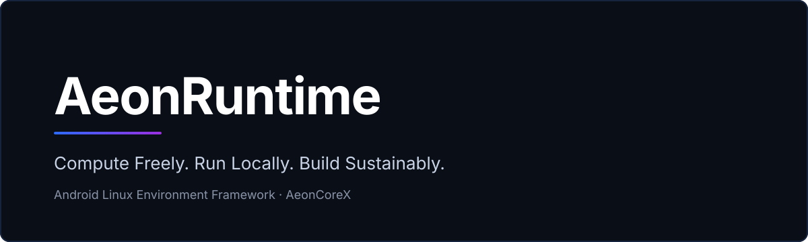

<p align="center">
  
</p>

<h1 align="center">AeonRuntime</h1>

<p align="center"><strong>Compute Freely. Run Locally. Build Sustainably.</strong></p>

<p align="center">
  
  
  
</p>

AeonRuntime is a modular Linux environment framework for Android applications, providing independent Linux
environments, multiple execution backends, Android system integrations, and a foundation for local AI computing.

> **Status: pre-release.** Nothing has been published to Maven Central or any other registry. This repository
> is the result of migrating the project's previous identity to AeonRuntime (old-to-new names are listed in
> [`docs/migration/RENAME_MAP.md`](docs/migration/RENAME_MAP.md)); see
> [`docs/migration/MIGRATION_REPORT.md`](docs/migration/MIGRATION_REPORT.md) for exactly what was verified and
> what was not. The *Roadmap* section lists everything that is **not** implemented yet.

---

## Why AeonRuntime exists

**Mission.** To provide Android applications with the freedom to create and manage independent Linux
environments, enable local computing and on-device AI capabilities, and help reduce unnecessary dependence on
centralized computing infrastructure through efficient and responsible computing.

**Vision.** Make powerful, independent, and resource-conscious Linux computing accessible directly within
Android applications.

AeonRuntime is a **reusable library/SDK for third-party apps**. It is not a terminal app and not a Termux clone:
the host application owns the UI and decides when and how an environment is created.

---

## What works today

| Capability | Module | Notes |
|---|---|---|
| Bootstrap download, extraction, verification and symlink handling | `:core` | Termux-derived userland (bash, apt, dpkg, coreutils…) installed into the app's private storage |
| Command execution (`run`, streaming, JSON output, Python / Node / Ruby / Perl / PHP / bash helpers) | `:core` | Coroutine-based; `ExecutionResult` with stdout / stderr / exit code |
| Package management (`pkg`/`apt`, pip, npm, gem) | `:core` | `PackageManager`, also reachable through `RuntimeBridge` |
| Native PTY and process management (JNI) | `:core` | 11 JNI functions; ABIs `arm64-v8a`, `x86_64`, `armeabi-v7a`, `x86` |
| Optional foreground service for long-running commands | `:core` | `RuntimeBackgroundService` |
| Linux distributions via **PRoot** (no root needed) | `:os` | Kali, Ubuntu 24.04 / 22.04, Debian 12, Alpine, Fedora 40, plus custom rootfs URLs |
| Linux distributions via **real chroot** (root required) | `:os` | Selected automatically when root is detected, or forced via `ExecutionMode` |
| Graphical sessions over VNC with Compose UI components | `:os` | `DesktopSession`, `VncClient`, Compose screens |
| Terminal view widget | `:terminal-view` | `TerminalView` |
| Elevated command execution through **Shizuku** (optional) | `:shizuku` | Needs Shizuku running and the user's permission; does **not** imply root |

### Execution engines

| Engine | Status |
|---|---|
| PRoot | Implemented (`:os`) |
| chroot | Implemented (`:os`, requires root) |
| QEMU | **Not implemented.** Future target. |
| User-Mode Linux (UML) | **Not implemented.** Future target. |

PRoot and chroot differ in isolation and privilege model; they are not interchangeable in capability.
See [`docs/architecture/execution-engines.md`](docs/architecture/execution-engines.md).

---

## Android compatibility

- `minSdk` 26 for `:core` and `:os` (`:terminal-view` and `:shizuku` currently declare 24, see
  [Known issues](docs/migration/KNOWN_ISSUES.md)); `compileSdk` 34.
- **Executing downloaded binaries (W^X).** Since Android 10 (API 29), a file an app writes into its own private
  storage cannot be `exec()`'d. The classic Termux workaround is `targetSdk ≤ 28`, which is what the sample app
  uses. `BootstrapProvider` / the `bootstrap-<abi>` modules are the library's path for supplying executables
  that Android allows (install-time native libraries). Treat API 29+ support as something to verify on your
  own target devices.
- **Prefix and package name.** Termux-style binaries have the install prefix compiled in. The upstream
  bootstrap is built for `/data/data/com.termux/files/usr`; for any other app that prefix does not match
  (`BootstrapInstaller` logs a warning). Build a bootstrap for your own `applicationId` with
  [`bootstrap-builder`](bootstrap-builder/README.md).
- Root is optional. Shizuku is optional. Neither is assumed.

---

## Architecture

```
Your app
   │
   ▼
AeonRuntime  (:core)  ── RuntimeBridge · CommandExecutor · PackageManager · BootstrapInstaller · VirtualFileSystem
   │                          │
   │                          └── JNI (libaeonruntime_jni.so): PTY, fork/exec, signals, symlinks
   ├── :os              distros, PRoot / chroot runners, VNC desktop, Compose components
   ├── :terminal-view   TerminalView
   ├── :shizuku         optional elevated execution
   └── :bootstrap-<abi> optional bootstrap payload per ABI (arm64, arm, x86_64, x86)
```

Package layout (`com.aeoncorex.aeonruntime`): `bootstrap`, `bridge`, `executor`, `filesystem`, `service`,
`packagemanager`, `initializer`, `utils`, `os`, `shizuku`, `terminal`. Details:
[`docs/ARCHITECTURE.md`](docs/ARCHITECTURE.md).

---

## Installation

Not published yet. Until a release exists, consume it from source:

```bash
./scripts/publish_local.sh        # publishes to ~/.m2 (local only)
```

```kotlin
// settings.gradle.kts
dependencyResolutionManagement { repositories { mavenLocal(); google(); mavenCentral() } }

// app/build.gradle.kts
dependencies {
    implementation("com.aeoncorex:aeonruntime-core:1.0.0")
    // optional modules
    implementation("com.aeoncorex:aeonruntime-os:1.0.0")
    implementation("com.aeoncorex:aeonruntime-terminal:1.0.0")
    implementation("com.aeoncorex:aeonruntime-shizuku:1.0.0")
    implementation("com.aeoncorex:aeonruntime-bootstrap-arm64:1.0.0")
}
```

These are the *intended* coordinates (group `com.aeoncorex`); `1.0.0` is the version currently set in
`gradle.properties` and has not been released.

---

## Integration example

```kotlin
class App : Application() {
    override fun onCreate() {
        super.onCreate()
        AeonRuntime.initialize(this) {
            logLevel = LogLevel.INFO
            env("MY_APP", "demo")
        }
    }
}

// Anywhere later (e.g. in a ViewModel)
val runtime = AeonRuntime.getInstance()

viewModelScope.launch {
    runtime.install().collect { state ->           // Flow<InstallState>
        when (state) {
            is InstallState.Downloading -> showProgress(state.progress)
            is InstallState.Failed      -> showError(state.error)
            InstallState.Completed,
            InstallState.AlreadyInstalled -> Unit
            else -> Unit
        }
    }
    val result = runtime.bridge.run("echo 'Hello from Linux'")
    println(result.stdout)                         // exit code: result.exitCode
}
```

From Java:

```java
AeonRuntime runtime = AeonRuntime.initialize(context, RuntimeConfig.builder().build());
```

Distributions (`:os`):

```kotlin
val os = runtime.createOs()                        // extension from the :os module
os.setupDistro(Distro.Debian12).collect { /* DistroSetupState */ }
val r = os.execute(Distro.Debian12, "uname -a")
```

More examples: [`docs/INTEGRATION_GUIDE.md`](docs/INTEGRATION_GUIDE.md).

> `AeonRuntime.initialize` is a process-wide singleton: after the first call, later calls return the existing
> instance and ignore their configuration.

---

## Build from source

Requirements: JDK 17, Android SDK (platform 34), and the NDK + CMake 3.22.1 that AGP installs on demand.

```bash
./scripts/setup_dev.sh
./gradlew :core:testDebugUnitTest
./gradlew :core:assembleDebug :os:assembleDebug :terminal-view:assembleDebug :shizuku:assembleDebug
./gradlew :sample:assembleDebug
python3 scripts/verify_repo.py && python3 scripts/verify_jni.py   # source-level checks, no SDK needed
```

Full instructions: [`docs/BUILDING.md`](docs/BUILDING.md). Bootstrap modules download the bootstrap zip at build
time and therefore need network access.

---

## Roadmap

Everything below is **planned, not implemented**.

1. **Engine abstraction.** A common lifecycle for execution engines. A documented migration plan exists;
   no interface has been added because the current PRoot/chroot runners are distro-centric.
   → [`docs/architecture/execution-engines.md`](docs/architecture/execution-engines.md)
2. **QEMU and UML engines**, each with explicit capability and isolation documentation.
3. **Local AI subsystem** (separate, optional module): model storage and lifecycle, CPU inference first,
   optional GPU/NPU bridges only where verified on real hardware. Candidates: llama.cpp, ONNX Runtime,
   MLC LLM, ExecuTorch. → [`docs/architecture/local-ai.md`](docs/architecture/local-ai.md)
4. **Resource awareness:** battery- and thermal-aware scheduling and memory management.
5. **Measurement.** Energy and cost benefits of local execution are goals to be *measured*, not assumed;
   local computing does not always use less energy than cloud computing.

---

## Contributing

See [`CONTRIBUTING.md`](CONTRIBUTING.md).

## License and attribution

AeonRuntime is licensed under the **Apache License 2.0**, see [`LICENSE`](LICENSE).
Copyright 2026 AeonCoreX-Lab / cybernahid-dev (as in the source headers).

AeonRuntime builds on the work of others and keeps their attribution intact:

- The bootstrap userland and packages come from the [Termux](https://github.com/termux/termux-packages)
  project (`termux-packages`) and remain under their own licenses; AeonRuntime does not relicense them.
- Distribution root filesystems are fetched from upstream sources such as
  [`termux/proot-distro`](https://github.com/termux/proot-distro) releases, under their respective licenses.
- [PRoot](https://proot-me.github.io/) and [Shizuku](https://github.com/RikkaApps/Shizuku) are third-party
  projects used under their own licenses.

Some identifiers deliberately keep their upstream "termux" spelling for compatibility
(`TERMUX_PREFIX`, `TERMUX_HOME`, `libtermux-exec.so`, `termux-packages` URLs). They are classified in
[`docs/migration/RENAME_MAP.md`](docs/migration/RENAME_MAP.md) and enforced by `scripts/verify_repo.py`.
